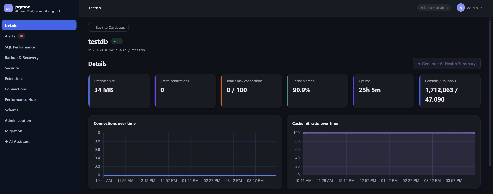
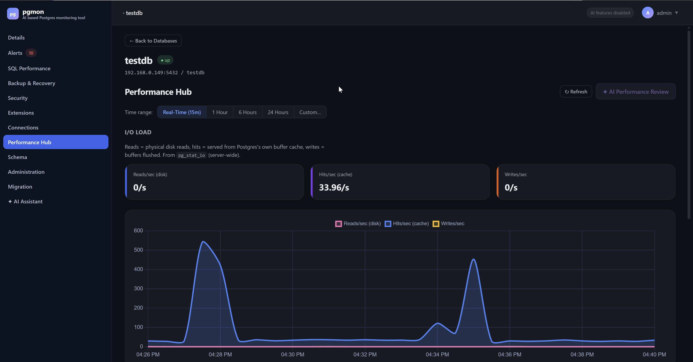
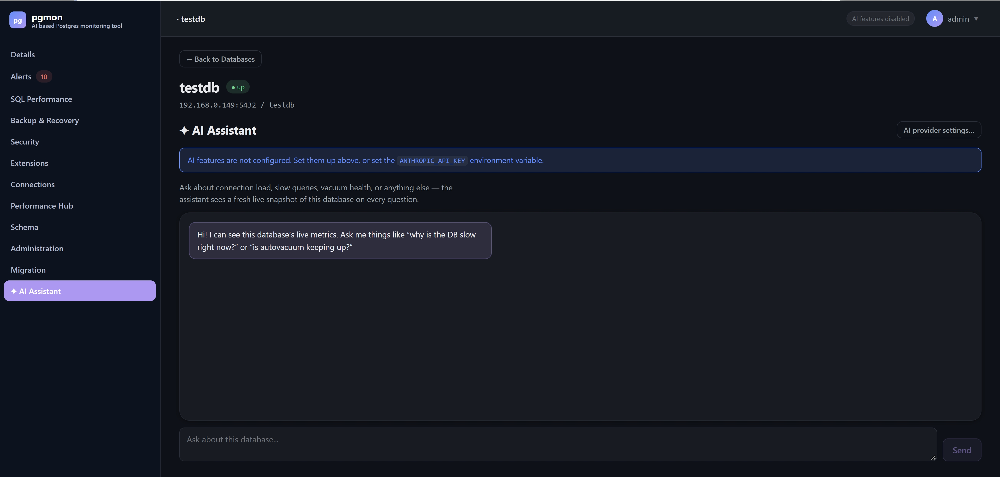

# pgmon — AI-Powered PostgreSQL Monitor

A self-hosted PostgreSQL monitoring, administration, backup, and migration
dashboard — with an optional AI assistant layered on top. Monitors only
what you explicitly register (no built-in default database).

**See [DOCUMENTATION.md](DOCUMENTATION.md) for the full feature tour,
architecture, and deployment details.**

## Screenshots

| Details | Performance Hub |
|---|---|
|  |  |

| AI Assistant |
|---|
|  |

## What it does

- **Monitoring**: live dashboards, rule-based alerts, slow-query analysis,
  connection/lock visibility
- **Wraparound protection**: transaction-ID and MultiXact age tracking with
  escalating alerts, and the specific table holding the freeze horizon back
- **Replication**: slot monitoring (an abandoned slot fills the disk and
  takes the instance down), standby lag in bytes as well as time
- **Alert delivery**: push alerts to Slack/Teams/PagerDuty/any webhook,
  de-duplicated so a steady-state problem doesn't page every 30 seconds
- **Administration**: VACUUM, partitioning advisor, bloat removal,
  live-editable settings
- **Security**: role/privilege management, SSL/auth checks, full audit log
- **Backup & Recovery**: logical and physical/incremental backups,
  scheduling, point-in-time recovery
- **Migration**: Oracle → Postgres and Postgres → Postgres
- **✦ AI Assistant**: ask plain-English questions about database health —
  optional, the tool works fully without it

## Getting it

| Deployment | Guide |
|---|---|
| Docker / Podman (self-contained, turnkey HTTPS) | [packaging/docker/](packaging/docker/README.md) |
| RPM (RHEL / Oracle Linux / Rocky / AlmaLinux 8/9/10, incl. air-gapped) | [packaging/rpm/](packaging/rpm/README.md) |
| Plain Linux (systemd + Nginx) | [packaging/linux/](packaging/linux/README.md) |
| Windows (MSI) | [packaging/windows/](packaging/windows/README.md) |
| Kubernetes (Helm) | [DEPLOYING.md](DEPLOYING.md) |
