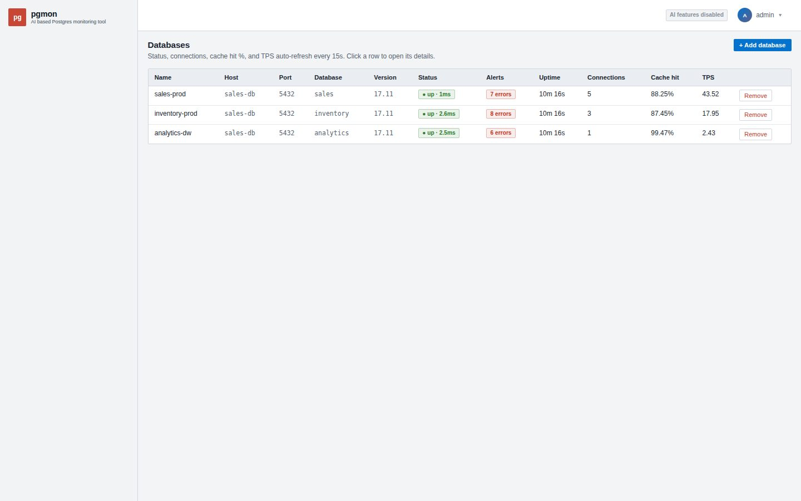
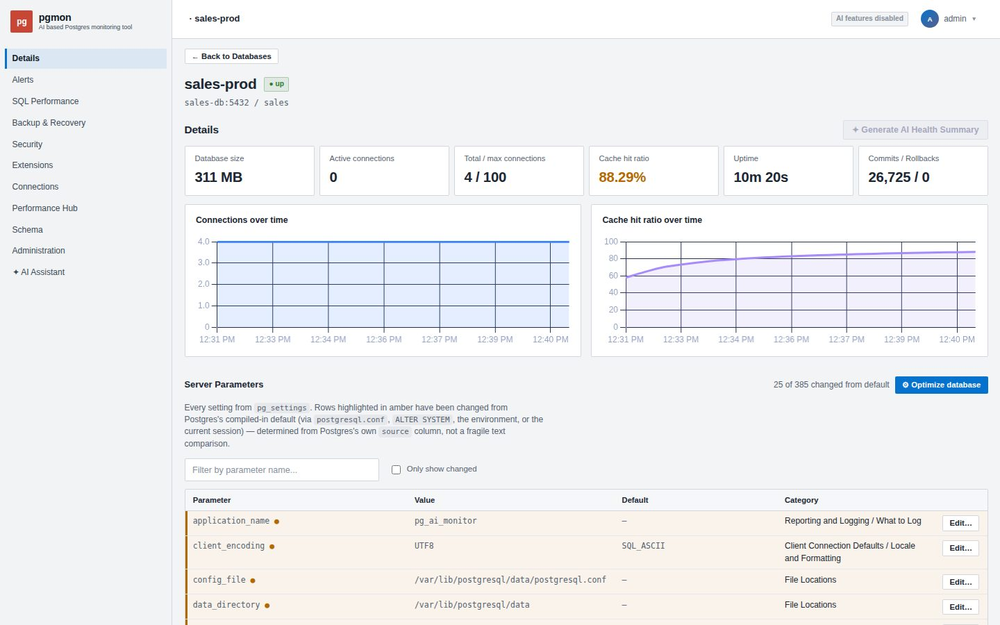
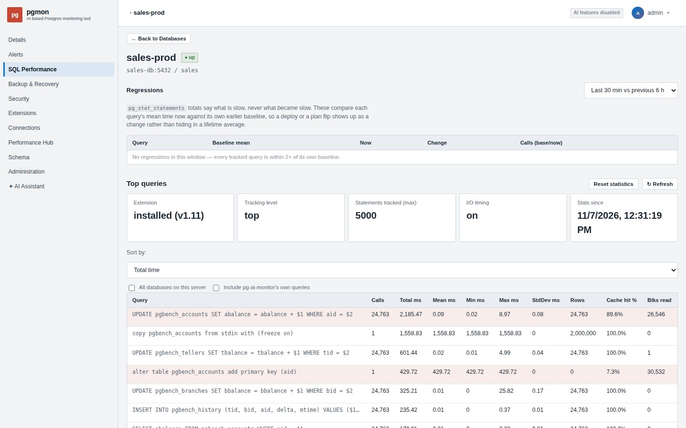
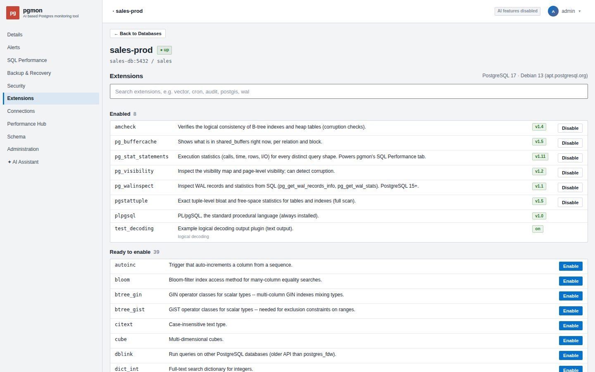
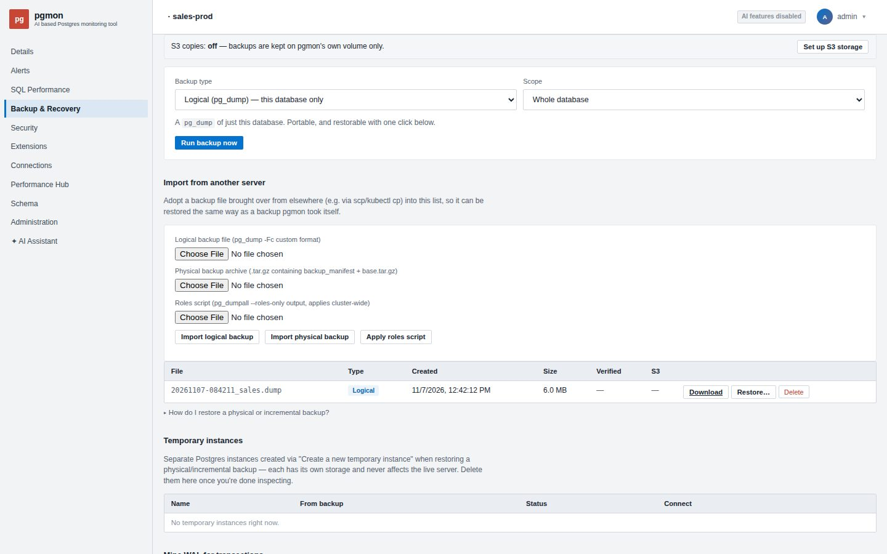

# pgmon — PostgreSQL monitoring and administration

A self-hosted web console for monitoring, tuning, backing up and
administering PostgreSQL, with an optional AI assistant on top. It monitors
only the databases you register, works over a normal database connection,
and runs as a single container, a native Linux/Windows install, or on
Kubernetes.

**[DOCUMENTATION.md](DOCUMENTATION.md)** has the full feature tour,
architecture and deployment details.

## Screenshots

| Databases | Details |
|---|---|
|  |  |

| SQL Performance | Extensions |
|---|---|
|  |  |

| Backup & Recovery |
|---|
|  |

## Features

- **Databases overview** — status, latency, connections, cache hit ratio,
  TPS, uptime and alert counts for every registered database.
- **Details** — size, connection and cache trends, every server parameter
  with live editing, and a pgtune-style *Optimize database* recommendation.
- **Alerts** — rule-based checks including transaction-ID/MultiXact
  wraparound, abandoned replication slots and standby lag; delivered to
  Slack, Teams, PagerDuty or any webhook, de-duplicated.
- **SQL Performance** — top queries from `pg_stat_statements`, regressions
  against each query's own baseline, execution plans, a deterministic
  tuning advisor and hypothetical-index checks (`hypopg`).
- **Backup & Recovery** — logical, physical and incremental backups on
  demand or on a schedule with retention; verification with the matching
  PostgreSQL version's tools; restores and point-in-time recovery; WAL
  archiving setup; WAL mining; and copies to any **S3-compatible bucket**
  (MinIO, Ceph, AWS S3 — including air-gapped endpoints with a private CA).
- **Security** — roles and privileges, `pg_hba` rules, SSL and
  authentication checks, and a full audit log of every change made through
  pgmon.
- **Extensions** — every extension the server offers plus ~260 packaged
  ones, one-click enable (dependencies and preload handled), and the exact
  install command for anything not yet on the server.
- **Connections** — live sessions and blocking locks, with terminate.
- **Performance Hub** — I/O, wait events and buffer-cache contents.
- **Schema** — browse objects with sizes, partitions, generated DDL and
  search.
- **Administration** — VACUUM, bloat detection, online repacking
  (`pg_repack`) and conversion of tables to partitioned tables.
- **✦ AI Assistant (optional)** — plain-English questions, health
  summaries and security reviews. Every other feature works without it.

Works with PostgreSQL 14–18, with superuser or `pg_monitor` logins, and
with CloudNativePG clusters (see DOCUMENTATION.md §6a).

## Getting it

| Deployment | Guide |
|---|---|
| Docker / Podman — self-contained, HTTPS out of the box | [packaging/docker/](packaging/docker/README.md) · [download the image](https://github.com/sharaththoniyot86/pgmon/releases/latest) |
| RPM — RHEL / Oracle Linux / Rocky / AlmaLinux 8, 9, 10, incl. air-gapped | [packaging/rpm/](packaging/rpm/README.md) |
| Plain Linux — systemd + Nginx | [packaging/linux/](packaging/linux/README.md) |
| Windows — MSI | [packaging/windows/](packaging/windows/README.md) |
| Kubernetes / Rancher — Helm chart | [DEPLOYING.md](DEPLOYING.md) |

Quick start with the released image:

```bash
docker load -i pgmon-1.0.0-docker.tar.gz
docker run -d --name pgmon -p 443:443 \
    -v pgmon-config:/etc/pgmon -v pgmon-data:/var/lib/pgmon \
    --restart unless-stopped pgmon:1.0.0
docker logs pgmon    # shows the generated admin password
```

Then browse to `https://<host>/` and add a database with **+ Add database**.

**PostgreSQL with every extension built in:** [postgres-image/](postgres-image/README.md)
builds `pgmon-postgres`, the official PostgreSQL image plus every
extension package from apt.postgresql.org, so each one is a click away in
the Extensions tab.
